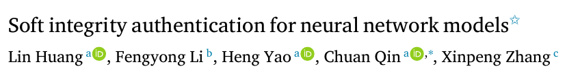

# Soft Integrity Authentication for Neural Network Models



**Lin Huang, Fengyong Li, Heng Yao, Chuan Qin, and Xinpeng Zhang**  
*Expert Systems with Applications*, 267, Article 126172, 2025.  
[Paper](https://doi.org/10.1016/j.eswa.2024.126172)

## Overview

The method uses semi-fragile fingerprint images to distinguish benign model updates from malicious modifications. The samples are designed to keep their expected predictions under benign changes while responding to malicious changes. A lightweight classifier uses model outputs to identify modification types.

## Code

| Entry point | Purpose |
| --- | --- |
| [`Samples_selection.py`](train_code/Samples_selection.py) | Select candidate fingerprint inputs. |
| [`Samples_generation.py`](train_code/Samples_generation.py) | Generate semi-fragile fingerprint samples. |
| [`SIA.py`](train_code/SIA.py) | Evaluate soft integrity authentication. |
| [`MTI.py`](train_code/MTI.py) | Evaluate modification type identification using model outputs. |

## Quick start

Prepare the CIFAR-10 ResNet-18 checkpoint and semi-fragile fingerprints using the [experiment setup](docs/EXPERIMENTS.md). The authentication entry point evaluates the original and dynamically quantized models. It can also evaluate specified fine-tuned, pruned and BadNet checkpoints.

```bash
python -m pip install -r requirements.txt
cd train_code
python SIA.py --limit 3
```

## Citation

Lin Huang, Fengyong Li, Heng Yao, Chuan Qin, and Xinpeng Zhang. “Soft Integrity Authentication for Neural Network Models.” *Expert Systems with Applications*, 267, Article 126172, 2025. [DOI](https://doi.org/10.1016/j.eswa.2024.126172)
